  

### 
# 💫 About Me:
📈I'm currently learning. 🧑‍🎓Student.

## 🌐 Socials:
 

# 💻 Tech Stack:
                                     
# 📊 GitHub Stats:
 
 

## 🏆 GitHub Trophies

### ✍️ Random Dev Quote

<!-- Proudly created with GPRM ( https://gprm.itsvg.in ) -->
